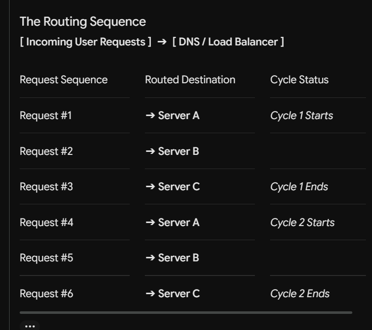

## DNS mostly respond with multiple ip address

## Algorithms

### Round robin
    DNS serves has a list of IP and will simply provice the ips in a sequcence order, there is no priority
    
    use case : Never used
    
